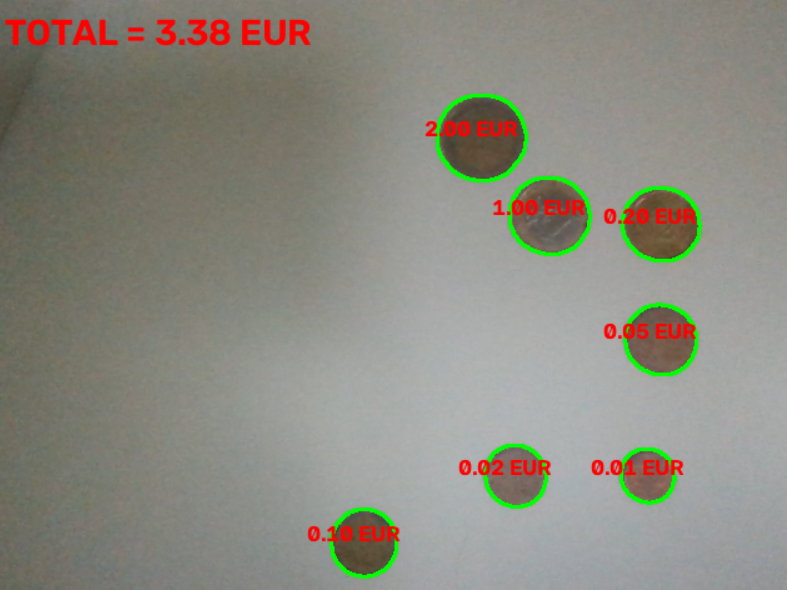
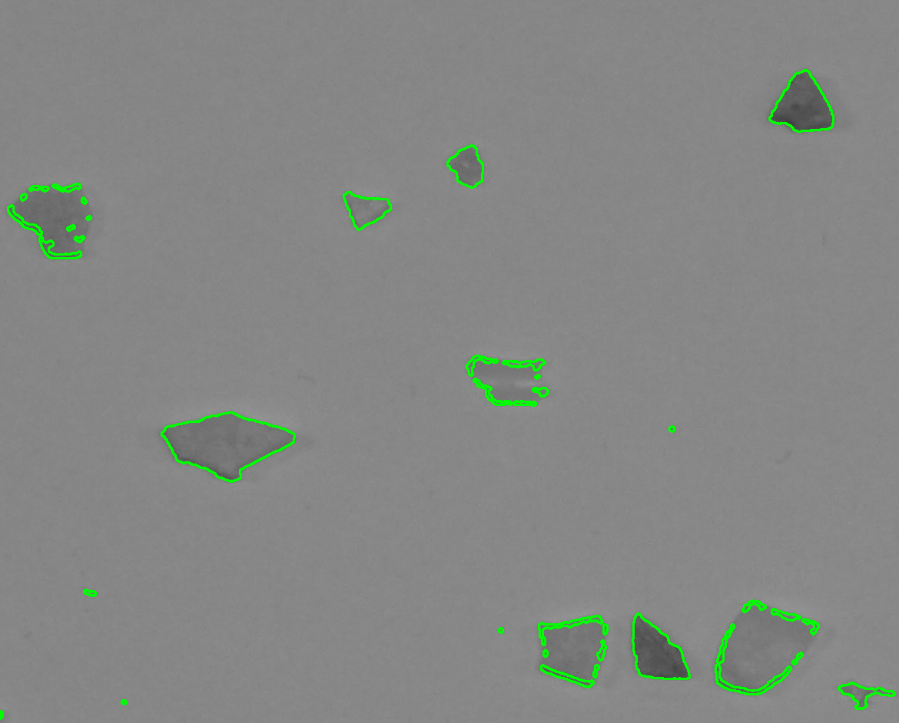
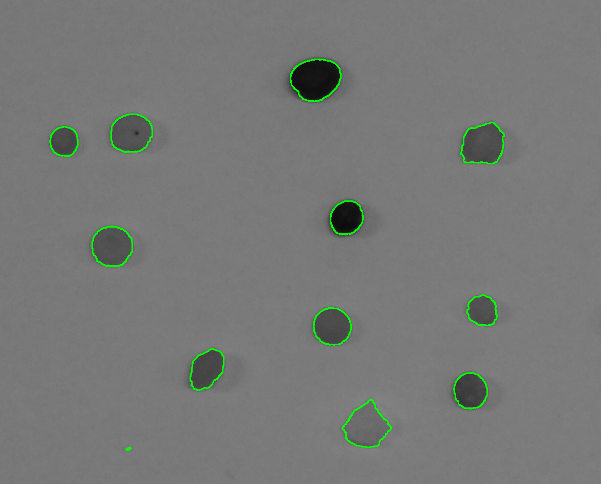
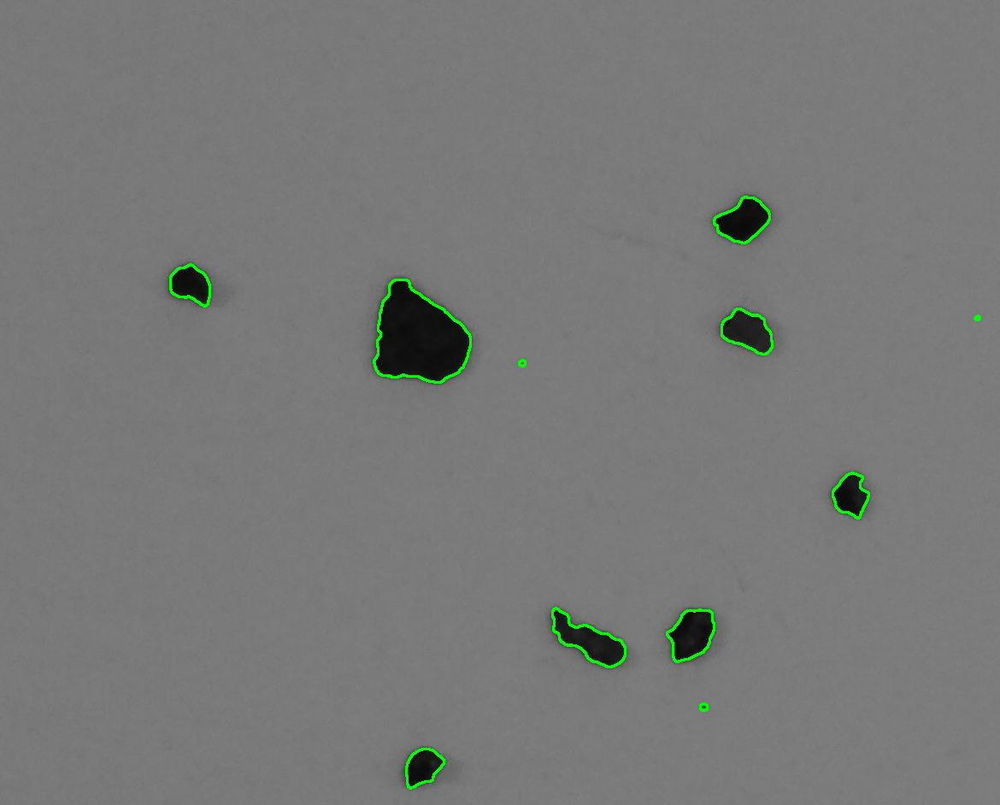
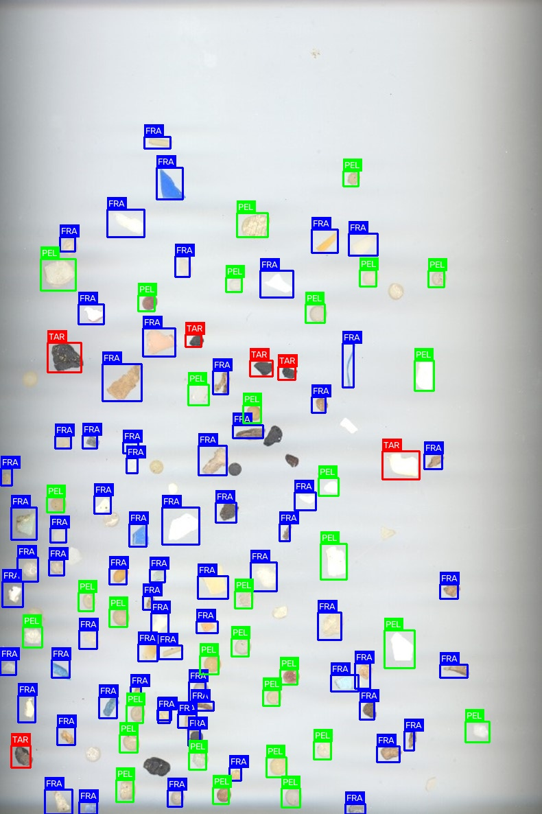
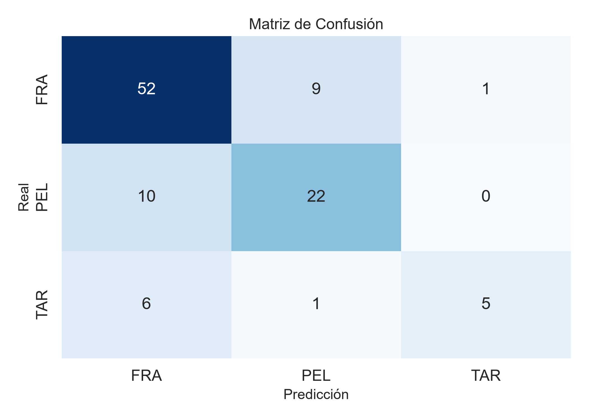

# Tarea 1: Detección y conteo del valor de las monedas
##Autores: Alejandro David Fariña Afonso y 

Este código utiliza la cámara en tiempo real para detectar monedas, medir sus diámetros y clasificarlas según su valor en euros. Para ello, se selecciona una moneda de referencia de 1 €, que permite calcular la escala de conversión de píxeles a milímetros. Finalmente, se muestra el valor de cada moneda detectada y se calcula la suma total del dinero y se muestra por pantalla.

* **Captura de vídeo:** Utiliza `cv2.VideoCapture(0)` para obtener imágenes en tiempo real desde la cámara y procesarlas continuamente.

* **Preprocesamiento de la imagen:** Convierte cada fotograma a escala de grises mediante `cv2.cvtColor` y aplica un filtro gaussiano (`cv2.GaussianBlur`) para reducir el ruido y facilitar la detección de las monedas.

* **Umbralización de Otsu:** Emplea `cv2.threshold` con `cv2.THRESH_BINARY_INV + cv2.THRESH_OTSU` para obtener una imagen binaria que permita separar los objetos del fondo automáticamente.

* **Detección de contornos:** Utiliza `cv2.findContours` para localizar los contornos externos de los objetos. Estos se dibujan en verde sobre la imagen del vídeo.

* **Selección de la moneda de referencia:** Al hacer clic sobre una moneda, se calcula su diámetro en píxeles mediante `cv2.minEnclosingCircle`. Esta moneda se considera de 1 €, cuyo diámetro oficial es de 23,25 mm, y se utiliza para calcular la escala de conversión a milímetros por píxel.

* **Medición y filtrado de monedas:** Una vez establecida la escala, se mide el diámetro de cada contorno detectado y se convierte a milímetros. Se descartan los objetos cuyo diámetro sea inferior al 55 % o superior al 115 % del diámetro de referencia, para reducir la detección de objetos demasiado pequeños o grandes.

* **Clasificación de las monedas:** La función `clasificar_moneda` compara el diámetro medido con los diámetros oficiales definidos en el diccionario `diametro_monedas` y selecciona el valor cuya medida sea la más cercana.

* **Visualización de resultados:** Como se ve en la siguiente imagen, se muestra el valor estimado de cada moneda en rojo y se dibuja el contorno de los objetos detectados en verde.



* **Cálculo del total:** El programa suma los valores de las monedas clasificadas y muestra el resultado en la parte superior izquierda de la imagen. La tecla `ESC` permite finalizar la ejecución y cerrar las ventanas.

Para esta tarea, se le preguntó a la Inteligencia Artificial ChatGPT sobre cómo se podría detectar un click dentro de uno de los contornos:
https://chatgpt.com/share/6ad90de0-f130-83ed-82e9-e888653a2903

# Tarea 2: Detección y Clasificación de Microplásticos

## Descripción General
Esta práctica aborda la detección, caracterización morfológica y clasificación automática de partículas contaminantes marinas (microplásticos y residuos) divididas en tres categorías principales:
- FRA (Fragmentos): Restos plásticos rígidos con bordes irregulares, aristas vivas y formas poligonales no simétricas.
- PEL (Pellets): Gránulos industriales de preproducción caracterizados por formas esféricas, elípticas y alta circularidad.
- TAR (Alquitrán/Tar): Agregados oscuros de hidrocarburos altamente absorbentes y de tonalidad casi negra.

El flujo de trabajo combina técnicas de visión por computador clásica (umbralización adaptativa local, operadores morfológicos, rellenado topológico y cálculo de descriptores invariantes de forma y brillo) con aprendizaje supervisado mediante Random Forest ponderado.

---

## 1. Preprocesamiento, Umbralización Adaptativa y Morfología Matemática

### Justificación de las técnicas:
1. Filtro Gaussiano (`cv2.GaussianBlur`): Atenúa el ruido de alta frecuencia del sensor y pequeñas motas del fondo sin difuminar excesivamente las fronteras de las partículas.
2. Umbralización Adaptativa Gaussiana Invertida (`cv2.adaptiveThreshold`): En imágenes macroscópicas sobre placas o cajas de escaneo, la iluminación no suele ser homogénea en toda la superficie (viñeteado y sombras suaves). Un umbral global fallaría en las esquinas o bordes de la imagen. La umbralización local calcula el corte en vecindarios de $25 \times 25$, e invierte la imagen (`THRESH_BINARY_INV`) para situar las partículas (más oscuras que la superficie) en valor 255.
3. Cierre Morfológico (`cv2.MORPH_CLOSE`): Con un elemento estructurante elíptico, conecta microfisuras e interrupciones del contorno perimetral causadas por reflejos de luz.
4. Rellenado Topológico de Huecos (`floodFill`): Muchas partículas presentan regiones internas translúcidas o reflejos especulares que provocan "agujeros" en la máscara. La técnica expande el fondo exterior desde la coordenada `(0, 0)` e invierte el resultado mediante una operación a nivel de bits (`OR` con el inverso), asegurando partículas completamente sólidas.
5. Apertura Morfológica (`cv2.MORPH_OPEN`): Elimina pequeñas partículas residuales antes de la extracción de contornos.

```python
def rellenar_huecos(binaria):
    flood = binaria.copy()
    mascara = np.zeros((binaria.shape[0] + 2, binaria.shape[1] + 2), np.uint8)
    # Rellena el fondo exterior desde (0, 0)
    cv2.floodFill(flood, mascara, (0, 0), 255)
    # Combina la máscara original con los huecos interiores invertidos
    return binaria | cv2.bitwise_not(flood)


def segmentar_particulas(img_gris):
    # 1. Reducción de ruido
    img_blur = cv2.GaussianBlur(img_gris, (5, 5), 0)
    
    # 2. Binarización adaptativa local sensible a variaciones de luz
    th = cv2.adaptiveThreshold(
        img_blur, 255, cv2.ADAPTIVE_THRESH_GAUSSIAN_C, 
        cv2.THRESH_BINARY_INV, 25, 3
    )
    
    # 3. Morfología para sellar contornos externos
    kernel = cv2.getStructuringElement(cv2.MORPH_ELLIPSE, (5, 5))
    th = cv2.morphologyEx(th, cv2.MORPH_CLOSE, kernel, iterations=2)
    
    # 4. Relleno de regiones internas translúcidas
    th = rellenar_huecos(th)
    
    # 5. Eliminación de ruido residual puntual
    th = cv2.morphologyEx(th, cv2.MORPH_OPEN, kernel, iterations=1)
    
    # Detección de contornos externos
    contornos, _ = cv2.findContours(th, cv2.RETR_EXTERNAL, cv2.CHAIN_APPROX_SIMPLE)
    return contornos
```

### Resultados de la Segmentación en Entrenamiento:

La segmentación aísla con precisión el perímetro de los fragmentos irregulares, la redondez de los pellets plásticos y los cúmulos oscuros de alquitrán:

| Fragmentos (FRA) | Pellets (PEL) | Alquitrán (TAR) |
| :---: | :---: | :---: |
|  |  |  |

---

## 2. Extracción de Descriptores Morfológicos, Invariantes y de Intensidad

### Justificación de los descriptores:
- Filtrado de área (`area < 15`): Desecha partículas mínimas que carecen de significancia.
- Compacidad y Circularidad: 
  $$\text{Compacidad} = \frac{\text{Perímetro}^2}{\text{Área}}, \quad \text{Circularidad} = \frac{4\pi \cdot \text{Área}}{\text{Perímetro}^2}$$
  Diferencian claramente la redondez típica de los pellets frente a las formas angulosas de los fragmentos.
- Cierre Convexo (Convex Hull), Solidez y Rugosidad:
  $$\text{Solidez} = \frac{\text{Área}}{\text{Área}_{\text{Hull}}}, \quad \text{Rugosidad} = \frac{\text{Perímetro}}{\text{Perímetro}_{\text{Hull}}}$$
  Miden las muescas y concavidades en el contorno, características de los fragmentos.
- Relación de Aspecto y Ajuste de Elipse (`axis_ratio`): Permiten capturar la elongación y excentricidad del objeto.
- Momentos de Hu en escala logarítmica: Proporcionan invariancia frente a traslación, escala y rotación bidimensional.
- Intensidad media y desviación estándar (`meanStdDev`): Esenciales para aislar la clase `TAR`, la cual destaca por una reflectancia muy reducida y valores de intensidad en escala de grises significativamente inferiores al resto.

```python
def extraer_caracteristicas_completas(contorno, imagen_gris):
    area = cv2.contourArea(contorno)
    if area < 15: 
        return None
        
    perimetro = cv2.arcLength(contorno, True)
    if perimetro == 0: 
        return None
        
    # Métricas de forma geométrica
    compacidad = (perimetro ** 2) / area
    circularidad = (4.0 * math.pi * area) / (perimetro ** 2)

    # Métricas de convexidad y concavidad
    hull = cv2.convexHull(contorno)
    hull_area = cv2.contourArea(hull)
    solidez = area / hull_area if hull_area > 0 else 0
    perimetro_hull = cv2.arcLength(hull, True)
    rugosidad = perimetro / perimetro_hull if perimetro_hull > 0 else 1.0
    
    # Bounding Box y relaciones de aspecto
    x, y, w, h = cv2.boundingRect(contorno)
    extent = area / (w * h) if w * h > 0 else 0
    aspect_ratio = float(min(w, h)) / max(w, h) if max(w, h) > 0 else 0
    
    # Ajuste por elipse para partículas con suficientes vértices
    if len(contorno) >= 5:
        _, (eje_menor, eje_mayor), _ = cv2.fitEllipse(contorno)
        axis_ratio = eje_menor / eje_mayor if eje_mayor > 0 else 0
    else:
        axis_ratio = aspect_ratio
        
    # Momentos invariantes de Hu (escalados logarítmicamente)
    M = cv2.moments(contorno)
    hu = cv2.HuMoments(M).flatten()
    hu_log = [-math.copysign(math.log10(abs(val)), val) if val != 0 else 0 for val in hu[:2]]

    # Descriptores fotométricos de textura y brillo
    mask = np.zeros(imagen_gris.shape, dtype=np.uint8)
    cv2.drawContours(mask, [contorno], -1, 255, -1)
    mean_val, std_val = cv2.meanStdDev(imagen_gris, mask=mask)
    
    return [
        compacidad, circularidad, solidez, rugosidad, 
        extent, aspect_ratio, axis_ratio, 
        hu_log[0], hu_log[1], mean_val[0][0], std_val[0][0]
    ]
```

---

## 3. Escalado y Entrenamiento del Modelo (*Random Forest*)

### Justificación de las técnicas:
1. Estandarización (`StandardScaler`): Descriptores como la compacidad pueden oscilar en valores de cientos, mientras que los ratios de aspecto se sitúan entre 0 y 1. Escalar a media 0 y varianza unitaria estabiliza el espacio de búsqueda.
2. Clasificador Random Forest: Es idóneo para datos tabulares con relaciones no lineales complejas entre descriptores morfológicos y fotométricos, ofreciendo baja varianza gracias al ensamble de árboles.
3. Ponderación de Clases (`class_weight`): Al existir un desbalance natural en el conjunto de entrenamiento (muchos más fragmentos que pellets o alquitrán), se asigna un peso superior a las clases minoritarias (`PEL: 3.5`, `TAR: 1.6`, `FRA: 0.9`) para penalizar más sus fallos en la función de coste.

```python
# Extracción en imágenes de entrenamiento y vectorización
scaler = StandardScaler()
X_train_scaled = scaler.fit_transform(X_train)

# Configuración del ensamble con pesos balanceados
clf = RandomForestClassifier(
    n_estimators=300, 
    max_depth=9, 
    min_samples_leaf=2,
    random_state=42, 
    class_weight={'FRA': 0.9, 'PEL': 3.5, 'TAR': 1.6}
)
clf.fit(X_train_scaled, y_train)
```

---

## 4. Inferencia sobre Datos de Test y Asociación Espacial por ROI

### Justificación de las técnicas:
1. Margen de Expansión en la ROI (`margen = 15`): Las cajas delimitadoras anotadas en el CSV pueden cortar ligeramente los bordes de la partícula. Añadir un margen de 15 píxeles asegura que la segmentación local capture la partícula entera.
2. Heurística de Mínima Distancia al Centro: En escenas de test con múltiples objetos contiguos, la subimagen recortada puede incluir partes de partículas vecinas. Se calcula la distancia euclídea entre el centroide de cada contorno detectado y el centro de la ROI para asociar el descriptor exclusivamente a la partícula objetivo del recuadro anotado.

```python
margen = 15 

with open(csv_file, newline="", encoding="utf-8") as file:
    reader = csv.DictReader(file)
    for row in reader:
        etiqueta_real = row["label"]
        x_min, y_min, x_max, y_max = map(int, [row["x_min"], row["y_min"], row["x_max"], row["y_max"]])
        
        # Recorte de la ROI con margen de seguridad
        y_min_m, y_max_m = max(0, y_min - margen), min(img_test.shape[0], y_max + margen)
        x_min_m, x_max_m = max(0, x_min - margen), min(img_test.shape[1], x_max + margen)
        
        roi = img_test[y_min_m:y_max_m, x_min_m:x_max_m]
        if roi.size == 0: 
            continue
            
        contornos_roi = segmentar_particulas(roi)
        
        if contornos_roi:
            centro_roi_x = roi.shape[1] // 2
            centro_roi_y = roi.shape[0] // 2
            
            mejor_contorno = None
            min_distancia = float('inf')
            
            # Búsqueda del contorno más cercano al centro del recuadro
            for c in contornos_roi:
                if cv2.contourArea(c) < 15 or cv2.contourArea(c) > (roi.shape[0]*roi.shape[1]*0.9): 
                    continue
                
                M = cv2.moments(c)
                if M["m00"] != 0:
                    cx, cy = int(M["m10"] / M["m00"]), int(M["m01"] / M["m00"])
                    dist = math.sqrt((cx - centro_roi_x)**2 + (cy - centro_roi_y)**2)
                    if dist < min_distancia:
                        min_distancia = dist
                        mejor_contorno = c
            
            # Extracción del vector de características para test
            if mejor_contorno is not None:
                feats = extraer_caracteristicas_completas(mejor_contorno, roi)
                if feats is not None:
                    X_test.append(feats)
                    y_true.append(etiqueta_real)
                    bbs_test.append((x_min, y_min, x_max, y_max))

# Normalización con el scaler original e inferencia
X_test_scaled = scaler.transform(X_test)
y_pred = clf.predict(X_test_scaled)
```

---

## 5. Renderizado, Métricas y Evaluación de Rendimiento

El sistema clasifica las partículas sobre la imagen completa y renderiza las cajas delimitadoras con el código cromático asignado: Azul para `FRA`, Verde para `PEL` y Rojo para `TAR`.

```python
colores = {
    'FRA': (255, 0, 0),  # Azul
    'PEL': (0, 255, 0),  # Verde
    'TAR': (0, 0, 255),  # Rojo
}

# Representación gráfica de predicciones sobre la imagen
for (x_min, y_min, x_max, y_max), pred in zip(bbs_test, y_pred):
    color = colores.get(pred, (0, 255, 255))
    cv2.rectangle(img_test_color, (x_min, y_min), (x_max, y_max), color, 2)
    # Etiquetado textual superior
    label_text = f"{pred}"
    (w_text, h_text), _ = cv2.getTextSize(label_text, cv2.FONT_HERSHEY_SIMPLEX, 0.45, 1)
    cv2.rectangle(img_test_color, (x_min, y_min - h_text - 6), (x_min + w_text + 4, y_min), color, -1)
    cv2.putText(img_test_color, label_text, (x_min + 2, y_min - 4), 
                cv2.FONT_HERSHEY_SIMPLEX, 0.45, (255, 255, 255), 1, cv2.LINE_AA)

# Evaluación con métricas cuantitativas
print(f"Accuracy:  {accuracy_score(y_true, y_pred):.4f}")
print(f"Precision: {precision_score(y_true, y_pred, average='weighted', zero_division=0):.4f}")
print(f"Recall:    {recall_score(y_true, y_pred, average='weighted', zero_division=0):.4f}")
print(f"F1 Score:  {f1_score(y_true, y_pred, average='weighted', zero_division=0):.4f}")

# Matriz de confusión
conf_matrix = confusion_matrix(y_true, y_pred, labels=etiquetas_unicas)
sns.heatmap(conf_matrix, annot=True, fmt='d', cbar=False, cmap='Blues', 
            xticklabels=etiquetas_unicas, yticklabels=etiquetas_unicas)
```

---

## Demostración y Resultados Finales

### Predicción en la Escena Completa de Test (`MPs_test.jpg`):
En la imagen resultante se aprecian las predicciones con recuadros delimitadores identificando cada partícula según su morfología y reflectancia:



### Matriz de Confusión y Análisis de Errores:
Permite verificar la separación de clases y la ausencia de solapamiento crítico entre `TAR` (debido al fuerte contraste de intensidad) y `PEL`/`FRA` (separados por métricas de circularidad y rugosidad):


