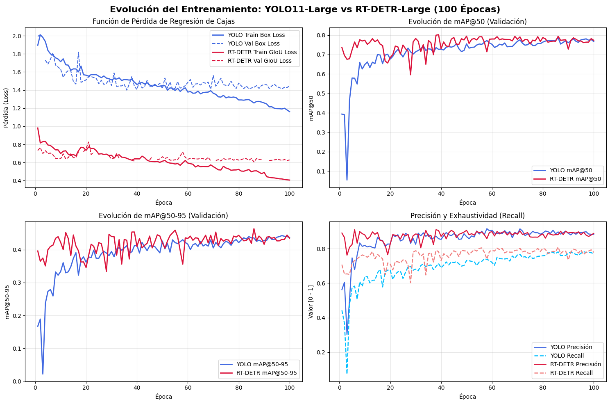

# Práctica 4: Detección y Seguimiento de Vehículos, Personas y Matrículas

**Asignatura:** Visión por Computador  
**Titulación:** Grado en Grado en Ingeniería Informática — ULPGC  
**Grupo:** G19  
**Autores:** Alejandro David Fariña Afonso y Carlos Luis Miranda Hernández

---

## Índice de Contenidos

1. [Entrenamiento del modelo YOLO con matrículas para su detección](#1-entrenamiento-del-modelo-yolo-con-matrículas-para-su-detección)
2. [Aplicación del modelo personalizado al vídeo: coches, personas y matrículas](#2-aplicación-del-modelo-personalizado-al-vídeo-coches-personas-y-matrículas)
3. [Entrenamiento del modelo RT-DETR y comparativa frente a YOLO](#3-entrenamiento-del-modelo-rt-detr-y-comparativa-frente-a-yolo)
4. [Comparativa de Reconocimiento Alfanumérico: EasyOCR frente a SmolVLM](#4-comparativa-de-reconocimiento-alfanumérico-easyocr-frente-a-smolvlm)
5. [Resolución integral de todos los extras](#5-resolución-integral-de-todos-los-extras)
6. [Dataset](#6-dataset)

---

## 1. Entrenamiento del modelo YOLO con matrículas para su detección

### 1.1 Objetivo y Estrategia
El objetivo inicial de la práctica consiste en disponer de un detector específico capaz de localizar placas de matrícula en vehículos. Dado que los modelos preentrenados en conjuntos generales (como COCO) no incluyen esta categoría, se requiere el entrenamiento supervisado de un detector basado en la familia YOLO (*Ultralytics*).

Se partió de una arquitectura preentrenada de la familia **YOLO11** (`yolo11l.pt` / `yolo11l.pt`) para aprovechar las características visuales aprendidas (*transfer learning*), readaptando la cabeza de detección a una única clase de interés (`plate`).

### 1.2 Configuración del Entrenamiento
Para el entrenamiento se estructuró el dataset anotado con la jerarquía estándar requerida por YOLO (`train`, `val` y `test` con subcarpetas `images` y `labels`), referenciadas a través del fichero de configuración `data.yml`:

```python
# Configuración clave del entrenamiento (Ultralytics YOLO)
from ultralytics import YOLO

model = YOLO("yolo11l.pt")
model.train(
    data="TGC_RBNW/data.yml",
    imgsz=640,
    batch=32,
    epochs=100,
    device=0,
    plots=True
)
```

### 1.3 Análisis del Comportamiento del Código
* **Resolución y Lote:** Se fijó una resolución de entrada de $640 \times 640$ píxeles (`imgsz=640`) con un tamaño de lote (`batch=32`), optimizando el compromiso entre la capacidad de capturar detalles pequeños en placas lejanas y la estabilidad del gradiente en GPU (`device=0`).
* **Función de Pérdida:** YOLO minimiza una pérdida conjunta compuesta por la regresión de cajas delimitadoras (*Box Loss* mediante CIoU), la distribución focal de bordes (*DFL Loss*) y la clasificación binaria de la presencia de placa (*Classification Loss*).
* **Convergencia:** A lo largo de las 100 épocas, el modelo reduce drásticamente la pérdida de localización durante las primeras 25-30 iteraciones, logrando estabilizar las cajas delimitadoras y maximizar la precisión en el conjunto de validación.
* **Pesos Obtenidos:** Los mejores pesos consolidados se almacenan automáticamente en `runs/detect/train-28/weights/best.pt`.

---

## 2. Aplicación del modelo personalizado al vídeo: coches, personas y matrículas

### 2.1 Enfoque Multimodelo en Inferencia
Para dar respuesta completa al enunciado básico, se procesó el vídeo de prueba (`C0142.MP4`) integrando dos modelos en paralelo dentro de un único bucle de lectura secuencial:
1. **Detector General COCO (`yolo11l.pt`):** Encargado de identificar a las personas (`class_id = 0`) y a los vehículos de interés (`car`, `motorcycle`, `bus`, `truck`).
2. **Detector Especializado de Matrículas (`best.pt`):** Modelo entrenado en el apartado anterior, encargado de inferir la ubicación exacta de las placas sobre los fotogramas.

### 2.2 Algoritmo de Seguimiento (*Tracking*) por Centroides y Conteo Único
Para realizar el recuento acumulativo sin duplicar identificadores en fotogramas sucesivos:
* **Cálculo de Centroides:** Para cada caja delimitadora devuelta por el modelo, se calcula su centro de masa espacial:
  $$cx = \frac{x_1 + x_2}{2}, \quad cy = \frac{y_1 + y_2}{2}$$
* **Asociación Espacial:** La función `assign_id()` calcula la distancia euclidiana entre el centroide actual y los centroides registrados en fotogramas previos. Si la distancia es inferior a un umbral de proximidad ($\text{threshold} = 50\text{ px}$), se conserva el mismo `oid` (*Object ID*); en caso contrario, se crea un nuevo ID único.
* **Registro de Conteo:** Se acumulan los identificadores en conjuntos (`set`), garantizando que la métrica de conteo refleje exclusivamente vehículos y personas individuales.

### 2.3 Generación del Archivo CSV de Detección
En cada iteración de frame se vuelcan al archivo `out/resultados_deteccion.csv` los 15 campos normalizados exigidos por el enunciado:

| Campo | Descripción |
| :--- | :--- |
| `fotograma` | Índice secuencial del fotograma procesado |
| `tipo_objeto` | Categoría detectada (`person`, `car`, `motorcycle`, etc.) |
| `confianza` | Confianza de la detección del objeto principal |
| `identificador_tracking` | ID único asignado por el algoritmo de seguimiento |
| `x1, y1, x2, y2` | Coordenadas de la caja delimitadora del objeto |
| `matricula_en_su_caso` | Etiqueta de matrícula si se detecta en la instancia |
| `confianza_matricula` | Confianza devuelta por el detector de placas |
| `mx1, my1, mx2, my2` | Coordenadas de la caja de la matrícula |
| `texto_matricula` | Texto leído de la matrícula (reservado para OCR) |

### 2.4 Inferencia en Vídeo con YOLO

[Vídeo de Salida: Detección y Seguimiento con Modelo YOLO Personalizado](https://youtu.be/A_h9OtTfnAg)
 

---

## 3. Entrenamiento del modelo RT-DETR y comparativa frente a YOLO

### 3.1 Motivación y Arquitectura RT-DETR
Frente a las arquitecturas tradicionales basadas en redes totalmente convolucionales (CNN), **RT-DETR** (*Real-Time DEtection TRansformer*) introduce el paradigma de los *Vision Transformers* para detección de objetos en tiempo real.

### 3.2 Entrenamiento de RT-DETR
Se utilizó el mismo dataset anotado (`TGC_RBNW/data.yml`) sobre la arquitectura `rtdetr-l.pt` durante **100 épocas**:

```python
# Configuración del entrenamiento RT-DETR-Large
from ultralytics import RTDETR

rtdetr_model = RTDETR("rtdetr-l.pt")
rtdetr_model.train(
    data="TGC_RBNW/data.yml",
    imgsz=640,
    batch=16,
    epochs=100,
    device=0,
    project="runs_matriculas",
    name="rtdetr_matriculas"
)
```

### 3.3 Inferencia en Vídeo con RT-DETR
De forma homóloga a la sección anterior, se ejecutó el modelo entrenado (`rtdetr_matriculas-2/weights/best.pt`) junto con el detector COCO sobre el vídeo de test, registrando las detecciones en `out/video_con_detecciones_rtdetr.mp4` y volcando los datos a `out/resultados_deteccion_rtdetr.csv`.

#### [Vídeo de Salida con RT-DETR](https://youtu.be/pri5_FQHyw8)

### 3.4 Comparativa Exhaustiva de Rendimiento (Época 100)

A partir de los registros de entrenamiento (`results.csv`) y la evaluación final sobre el subconjunto de test, se obtuvieron las siguientes métricas comparativas:

| Métrica de Rendimiento | YOLO11 (train-28) | RT-DETR-Large (matriculas-2) | Análisis Comparativo |
| :--- | :---: | :---: | :--- |
| **Precisión (P)** | **88.20%** (0.882) | **88.79%** (0.888) | RT-DETR logra un ligero incremento (+0.59%) en la tasa de acierto de cajas positivas. |
| **Exhaustividad (Recall)** | **77.05%** (0.771) | **77.84%** (0.778) | RT-DETR detecta un mayor porcentaje de placas difíciles (+0.79%). |
| **mAP@50** | **76.72%** (0.767) | **77.31%** (0.773) | Rendimiento global similar con leve ventaja para la arquitectura Transformer. |
| **mAP@50-95** | **43.70%** (0.437) | **43.53%** (0.435) | YOLO conserva un ajuste marginalmente más preciso en umbrales estrictos de IoU. |
| **Pérdida de Localización** | *Box Loss* (CIoU + DFL) | *GIoU Loss* + L1 | Ambas curvas muestran convergencia monótona estable a 100 épocas. |
| **Inferencia / Latencia** | Menor consumo de VRAM y tiempo de inferencia | Mayor coste de cómputo por mecanismo de atención | YOLO resulta más adecuado para entornos con recursos limitados o alta tasa de FPS. |

### 3.5 Salidas y Resultados Multimedia

#### Gráficas Comparativas de Entrenamiento (YOLO vs RT-DETR)
<div align="center">
  
  <p><sub><i><b>Figura 1:</b> Evolución de la Función de Pérdida, mAP@50, mAP@50-95 y curvas de Precisión/Recall a lo largo de 100 épocas.</i></sub></p>
</div>

Al analizar las métricas, se observa la evolución del entrenamiento entre los modelos YOLO11-Large y RT-DETR-Large a lo largo de 100 épocas. Inicialmente, RT-DETR demuestra una rápida convergencia, comenzando con menores valores de pérdida en la regresión de cajas y métricas de precisión (mAP@50 y mAP@50-95) mucho más altas que YOLO11. Por su parte, YOLO arranca desde niveles muy bajos pero experimenta un aprendizaje acelerado y pronunciado en las primeras 20 épocas. Hacia el final del proceso, ambos modelos logran estabilizarse y cerrar la brecha, alcanzando niveles de precisión máxima (Precision) casi idénticos. No obstante, RT-DETR mantiene una leve pero constante superioridad en la exhaustividad (Recall) y una menor pérdida de validación durante toda la prueba.   

Aunque ambos modelos convergen hacia un rendimiento general muy parejo y altamente competitivo tras 100 épocas, RT-DETR-Large demuestra ser un modelo más robusto, ya que aprende y se estabiliza más rápido desde el inicio y ofrece una ligera ventaja sostenida en su capacidad para identificar todos los objetos relevantes. 

---

### Observaciones:
* Aunque las métricas cuantitativas en la carpeta de test revelan un rendimiento global muy parecido entre ambos modelos (mAP@50 de ~77%), la evaluación en vídeo evidencia que RT-DETR-Large ofrece una detección más efectiva gracias a su mayor capacidad para capturar las matrículas difíciles.

---

## 4. Comparativa de Reconocimiento Alfanumérico: EasyOCR frente a SmolVLM

### 4.1 Enfoques de Reconocimiento Evaluados
Para la extracción del texto alfanumérico contenido en las regiones de matrícula detectadas, se integraron y compararon dos metodologías diferentes:

1. **Pipeline Clásico de OCR (`EasyOCR`):** Basado en detección de caracteres tradicional combinada con redes convolucionales/recurrentes (`easyocr.Reader(['es', 'en'], gpu=True)`).
2. **Modelo Vision-Language (`SmolVLM`):** Modelo multimodal autoregresivo de 256 millones de parámetros (`HuggingFaceTB/SmolVLM-256M-Instruct`), que aborda la lectura mediante procesamiento guiado por instrucciones en lenguaje natural.

### 4.2 Estrategias de Preprocesamiento y Postprocesamiento

#### Pipeline con EasyOCR
* **Preprocesamiento por Variantes de Imagen:** Se implementó un generador en cascada (`variantes_ocr`) que evalúa secuencialmente sobre el recorte ajustado: imagen original reescalada ($\text{alto} \ge 96\text{ px}$), realce de contraste adaptativo mediante CLAHE (`clipLimit=2.0`, `tileGridSize=(4,4)`), y binarización adaptativa mediante el algoritmo de Otsu.
* **Segmentación de Matrículas de Dos Filas:** La función `separar_filas()` detecta placas cuadradas ($\text{ancho}/\text{alto} < 2.2$), calcula el perfil de densidad vertical de tinta sobre el 80% central del ancho y realiza un corte horizontal en el mínimo de densidad entre el 35% y el 65% de la altura.
* **Corrección Posicional Sintáctica:** El texto extraído se valida con la expresión regular `([0-9OQDILSZEAGBT]{4})([0-9OIZEA5G7BP]{3})` y se somete a sustitución posicional estricta:
  * *Posiciones 0–3 (Números):* `digit_map = {'O':'0', 'Q':'0', 'D':'0', 'I':'1', 'L':'1', 'Z':'2', 'E':'3', 'A':'4', 'S':'5', 'G':'6', 'B':'8', 'T':'7'}`.
  * *Posiciones 4–6 (Letras):* `letter_map = {'0':'O', '1':'I', '2':'Z', '3':'E', '4':'A', '5':'S', '6':'G', '7':'T', '8':'B', '9':'P'}`.

#### Pipeline con SmolVLM
* **Inferencia Visual Directa:** El recorte BGR de OpenCV se convierte a espacio de color RGB de PIL (`Image.fromarray`). Se estructura una plantilla de conversación (`apply_chat_template`) con inferencia en precisión `torch.float16` en GPU.
* **Prompting Instructivo:**
  ```python
  PROMPT = (
      "Read the vehicle license plate. Return only the letters and digits, without "
      "explanation. For two rows, read the top row first, then the bottom row. "
      "If unreadable, return an empty string."
  )
  ```
* **Postprocesamiento:** Filtrado alfanumérico mediante `re.sub(r'[^A-Z0-9]', '', texto.upper())` extrayendo los 7 caracteres alfanuméricos consolidados.

### 4.3 Cuadro Comparativo de Integración y Inferencia

| Característica | Pipeline EasyOCR | Pipeline SmolVLM (256M) |
| :--- | :--- | :--- |
| **Arquitectura** | Motor OCR profundo tradicional | Vision-Language Model (VLM) Transformers |
| **Tratamiento Doble Fila** | Segmentación explícita mediante densidad de tinta | Tratamiento implícito vía prompt (*"read top row first..."*) |
| **Robustez ante Iluminación** | Requiere transformaciones explícitas (CLAHE / Otsu) | Tolerancia inherente a variaciones de contraste |
| **Postprocesamiento** | Mapeo de sustitución posicional estricto (Números vs Letras) | Filtrado sintáctico alfanumérico simple |
| **Manejo de Errores** | Retorna `"OCR_ERROR"` ante fallos sintácticos | Retorna `"OCR_ERROR"` si la cadena resulta $< 7$ caracteres |
| **Consumo y Carga** | Muy ligero en VRAM y rápida ejecución en batch | Mayor ocupación de VRAM y tiempo de generación (`generate`) |

### 4.4 Inferencia en Vídeo con YOLO

[Vídeo de Salida: Detección y Seguimiento con Modelo YOLO usando OCR](https://youtu.be/eGes9XXstZs)

[Vídeo de Salida: Detección y Seguimiento con Modelo YOLO usando VLM](https://youtu.be/aJY7KZxR9-Y)

[Vídeo de Salida: Detección y Seguimiento con Modelo RT-DETR usando OCR](https://youtu.be/u9FenNvnF3s)

[Vídeo de Salida: Detección y Seguimiento con Modelo RT-DETR usando VLM](https://youtu.be/xtdP-ryee5Q)


---

## 5. Resolución integral de todos los extras

En esta sección se resuelven conjuntamente todas las funcionalidades extras planteadas en el enunciado en una única arquitectura de procesamiento de vídeo:

```
                                  [ Fotograma de Entrada ]
                                             │
                       ┌─────────────────────┴─────────────────────┐
                       ▼                                           ▼
          [ Seguimiento Persistente ]                   [ Recorte de Vehículo ]
          (YOLO11-Large + BoT-SORT)                                │
                       │                                           ▼
             ┌─────────┴─────────┐                   [ Detección de Matrícula ]
             ▼                   ▼                   (Doble Rama de Contornos)
       [ Personas ]        [ Vehículos ]                           │
             │                   │                         ┌───────┴───────┐
             ▼                   │                         ▼               ▼
     [ Anonimización:            │                   [ Morfología ]   [ Canny/Bordes ]
        Pixelado ]               │                         └───────┬───────┘
                                 │                                 ▼
                                 │                    [ Scoring Multicriterio ]
                                 │                                 │
                                 └────────────────┬────────────────┘
                                                  ▼
                                       [ Anonimización de Placa:
                                            Gaussian Blur ]
                                                  │
                                                  ▼
                                     [ Análisis de Flujo Direccional:
                                       Fondo / Izquierda / Derecha ]
```

### 5.1 Detección de Matrículas mediante Contornos y Visión Clásica (+0.25p)
Como alternativa a los modelos de *Deep Learning*, la función `detect_plate_contours()` procesa el tercio inferior de cada recorte de vehículo mediante dos ramas paralelas de filtrado:
* **Rama A (Morfología Matemática ALPR):** Aplica la transformación *Black-Hat* para resaltar estructuras oscuras sobre fondos claros, extrae el gradiente horizontal con el operador Sobel en $X$, ejecuta un cierre morfológico rectangular `(15, 5)` para conectar los caracteres de la matrícula y binariza mediante el algoritmo de Otsu guiado por una máscara de luminancia HSV.
* **Rama B (Bordes y Detección de Contornos):** Reduce el ruido preservando bordes mediante filtrado bilateral, calcula bordes con Canny adaptativo basado en la mediana de la imagen y cierra discontinuidades con un elemento estructurante `(3, 3)`.
* **Módulo de Puntuación Multicriterio (*Scoring*):** Cada contorno devuelto se evalúa en función de:
  * *Relación de Aspecto (Aspect Ratio):* Se premia el rango típico de matrículas rectangulares ($1.7 \le \text{AR} \le 6.2$, con bonificación especial para el formato europeo $\sim 4.5$).
  * *Rectangularidad:* Relación entre el área del contorno y el área de su rectángulo envolvente ($\ge 0.42$).
  * *Densidad de Aristas y Gradiente:* Comprueba la presencia de caracteres alfanuméricos mediante la densidad de transiciones de borde en el interior de la región.
  * *Centralidad Espacial:* Pondera positivamente que la placa esté alineada con el eje horizontal central del vehículo.
* **Fusión por IoU y Memoria Temporal:** Si los mejores contornos de ambas ramas coinciden espacialmente ($\text{IoU} > 0.45$), se incrementa la confianza final. Además, un diccionario de persistencia temporal (`plate_memory`) mantiene la localización de la placa frente a vibraciones u oclusiones momentáneas.

### 5.2 Análisis del Flujo de Tráfico Direccional (+0.25p)
La función `analyze_flow()` determina la dirección por la que personas y vehículos abandonan el plano visible:
* **Vector de Desplazamiento:** Mantiene un historial deslizante de posiciones (`track_history`) para cada identificador y calcula el vector de movimiento neto:
  $$\Delta x = cx_{\text{actual}} - cx_{\text{inicio}}, \quad \Delta y = cy_{\text{actual}} - cy_{\text{inicio}}$$
* **Clasificación Espacial:**
  * **Fondo:** Si el objeto avanza hacia el horizonte ($\Delta y < -\text{umbral}$) en la mitad superior de la vía ($cy < 0.48 \cdot H$).
  * **Izquierda:** Si el objeto se ubica en el cuadrante izquierdo y su vector se dirige hacia la izquierda o salida inferior ($\Delta x < -\text{umbral} \lor \Delta y > \text{umbral}$).
  * **Derecha:** Si el objeto se ubica en el cuadrante derecho y su trayectoria apunta hacia la derecha o salida inferior ($\Delta x > \text{umbral} \lor \Delta y > \text{umbral}$).
* **Recuento Único:** Un conjunto de control (`counted_ids`) asegura que cada objeto compute una única vez en el panel global `flow_counts`.


### 5.3 Anonimización Dinámica en Tiempo Real (+0.25p)
La función `anonymize_roi()` preserva la privacidad en el vídeo mediante dos técnicas diferenciadas según la naturaleza del objeto:
* **Personas (Pixelado):** Para evitar la identificación facial y corporal, se reduce la región de interés a una décima parte de su tamaño original y se reescala a las dimensiones iniciales mediante interpolación por vecinos más próximos (`cv2.INTER_NEAREST`).
* **Vehículos / Matrículas (Desenfoque Gaussiano):** Sobre la caja delimitadora devuelta por el localizador de matrículas se aplica un desenfoque gaussiano suave con núcleo proporcional a las dimensiones de la placa, impidiendo la lectura del texto sin degradar la visibilidad general del vehículo.

### 5.4 Salidas y Resultados Multimedia

#### [Resolución con Todos los Extras](https://youtu.be/hlJT4Kkg96c) 
---

### Observaciones
* Se utilizaron diversas estrategias para la detección de contornos, pero el resultado más efectivo fue esta metodología utilizada.

---

## 6. Dataset


### Enlaces y Créditos

* **Enlace al Dataset:** [Google Drive](https://drive.google.com/drive/folders/1RFd6sKH_QMQcpE_w5rWmy8rKiYUY5_SI?usp=drive_link)
* **Autoría - Dataset Matrículas - Visión por Computador ULPGC 2026/27**

Organización y creación del dataset:
- Alejandra Rodríguez Silva

Creación de script para anotar:
- José Marcial Galván Franco
- Solmaire Basulto Santana

Anotaciones:
- Arael Jesús Almeida González
- Juan Francisco Almeida Santana
- Eduardo Arbelo Rua-Figueroa
- Solmaire Basulto Santana
- Ubay Antonio Batista Santana
- Texenery Bordón Rodríguez
- Pablo Campos Rico
- Dylan A. Castrillón Suárez
- Pablo Damas Negrín
- Vidal de León Giménez
- Naiara Díaz Hernández
- Alejandro David Fariña Afonso
- José Marcial Galván Franco
- Ricardo García Rodríguez
- Álvaro García Suárez
- Carla Gómez García
- David González Espino
- Marcos González Gómez
- Néstor Jesús Henríquez Medina
- Juan Daniel López Melainine
- Iván Luján Moreno
- Alejandro José Martel Torres
- Félix José Miguel Velásquez
- Carlos Luis Miranda Hernández
- Mencey Montesdeoca Álamo
- Yenedey Morán Delgado
- José Miguel Ojeda Hernández
- Alba Ramos Quintana
- Ángel Sergio Reyes Guedes
- Roberto Rodríguez Guillén
- Sergio Rodríguez Rubio
- Alejandra Rodríguez Silva
- Alicia María Rodríguez Trujillo
- Carmelo Aidan Romero Pérez
- Kilian Santana Delgado
- Cristina Santana Martín
- Erick Justo Sosa
- Enrique Sosa Ojeda
- Cristian Tomás Vega Appelqvist

---

### Observaciones:
* Hubo errores en la creación de anotaciones, por lo que se tuvieron que repetir diversos entrenamientos, ajustando la conversión del formato JSON a .txt —necesario por parte de YOLO y RT-DETR— para mejorar los resultados en la detección de matrículas.

